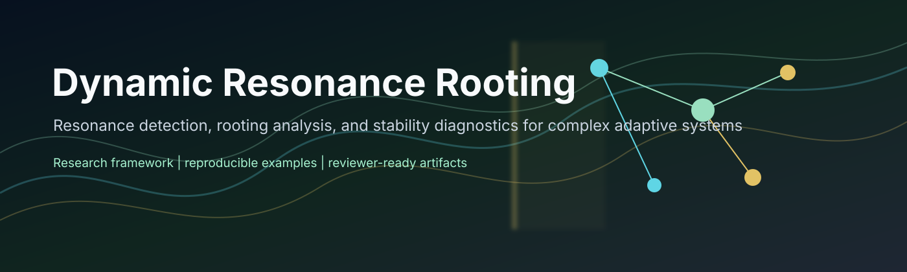

# Dynamic Resonance Rooting

[](#live-lab)

**Measure the rhythm. Trace the lag. Keep the evidence.**

Dynamic Resonance Rooting (DRR) is an open-source Python research framework for exploring **what repeats, what leads, and what changes** in multivariate time series. Find recurring frequencies, test relationships between signals, and export a record that others can inspect and reproduce.

[](https://github.com/topherchris420/dynamic-resonance-rooting/actions/workflows/python-app.yml)
[](pyproject.toml)
[](LICENSE)

**[Run your first analysis](#quick-start)** · **[Explore the browser lab](#live-lab)** · **[Inspect the evidence](#what-the-evidence-says)** · **[Contribute](#contribute)**

> **Research status:** DRR produces diagnostics. A directed edge is a statistical lead–lag relationship under a chosen estimator and null model; it does not establish causation. Evidence from one domain does not automatically transfer to another.

<a id="what-it-does"></a>

## What you can explore

Start with a simulated oscillator, a sensor recording, or your own regularly sampled CSV. DRR connects signal analysis to explicit tests and reproducible outputs.

| Your question | Tools to explore it | What you get |
| --- | --- | --- |
| **What repeats?** | FFT, Welch, wavelets, and resonance depth | Dominant frequencies, spectral power, and depth components |
| **What tends to lead?** | Lagged correlation or transfer entropy with surrogate tests | Candidate edges, significant edges, lags, and p-values |
| **What changed?** | State-space, topology, and structural-surprise diagnostics | Estimated states, structural changes, and uncertainty to investigate |
| **Do two rhythms keep time?** | Experimental `n:m` phase-synchrony test with a data-quality gate | Phase-locking value, shift-test p-value, inconclusive labels, and evidence records |
| **What could a bounded input change?** | Navigation engine and matched control experiments | Proposed interventions and comparison metrics in a simulated system |

The phase-synchrony features are **experimental and off by default**. See the [mathematical extensions](docs/mathematical-extensions.md) for assumptions and definitions.

## Quick start

Use **Python 3.8 or newer**. From a terminal:

```bash
git clone https://github.com/topherchris420/dynamic-resonance-rooting.git
cd dynamic-resonance-rooting
python -m pip install -e .
drr-reproduce --no-artifacts
```

Your first run analyzes three synthetic channels: a **12.5 Hz source**, a copy delayed by **two samples**, and an independent distractor. It prints a JSON summary without writing files. Look for these fields:

```json
{
  "expected_edge": "dim_0 -> dim_1",
  "expected_edge_detected": true,
  "expected_lag_samples": 2
}
```

This is an excerpt of the output. The fixture checks recovery of known, injected structure; it does not establish performance on your own data.

To save the summary as JSON and CSV:

```bash
drr-reproduce --output-dir results/reproduction
```

<details>
<summary><strong>Use the Python API</strong></summary>

The same synthetic generator lets you work directly with the spectral, depth, and rooting operators:

```python
from drr_framework import DynamicResonanceRooting, generate_coupled_oscillator

_, data = generate_coupled_oscillator(random_state=42)
result = DynamicResonanceRooting(tau=2, sampling_rate=200).analyze_system(
    data,
    multivariate=True,
    window_size=256,
    state_space=False,
    rooting_max_lag=4,
    rooting_n_surrogates=25,
    rooting_random_state=42,
)

print("Dominant frequency (Hz):", result["resonances"]["dim_0"]["dominant_freq"])
print("Resonance depths:", result["resonance_depths"])
for edge in result["rooting_analysis"]["significant_edges"]:
    print(edge["source"], "→", edge["target"], "lag:", edge["lag"])
```

On this seeded fixture, look for a dominant frequency near **12.5 Hz** and `dim_0 → dim_1` at lag `2`. `candidate_edges` are exploratory; `significant_edges` pass the selected surrogate test and correction. The small budget of 25 surrogates keeps this example quick; choose an appropriate inference budget for your study.

</details>

## Live lab

**Set the truth. See what DRR finds.** The browser lab streams three channels while you control coupling, delay, rhythm, and noise. Compare the detected graph with the known relationship and watch the tally of recovered edges, misses, and false alarms.

After cloning the repository, run this from its root directory. The lab does not require installing the Python package:

```bash
python -m http.server 8000 --bind 127.0.0.1
```

Open **[the local lab](http://127.0.0.1:8000/#lab)** in your browser. Stop the server with `Ctrl+C` when finished. The repository's [`index.html`](index.html) link shows the source on GitHub; the local server runs the page.

Try this short experiment:

1. **Observe the default system.** Compare “DRR found” with “Ground truth” as new windows arrive.
2. **Change the delay.** Set it to four samples, click **New window**, and check the estimated lag.
3. **Cut the link.** Every reported edge is now a false alarm. Collect several windows, then raise the noise and see how the results change.

Each 512-sample window runs through a [JavaScript port of the operators](assets/web-demo/drr-engine.js), with [parity tests against the Python package](tests/test_web_engine_parity.py). The evidence charts use committed benchmark artifacts, including the external result that did not support the claim.

## Analyze your own data

Start with the included CSV, then substitute your file, signal columns, and sampling rate:

```bash
drr-analyze data/raw/coupled_oscillator_sample.csv \
  --columns dim_0 dim_1 dim_2 --sampling-rate 200 \
  --time-column time_seconds --output-dir results/my-first-analysis
```

| Output | What it contains |
| --- | --- |
| `report.md` | A readable summary of channel frequencies, depth, tested edges, and interpretation boundaries |
| `analysis.json` | Full results, source SHA-256, parameters, random seed, dependency versions, and null assumption |

Use a **new output directory for every run**. The command preserves channel names and never silently drops or imputes rows. Selected values must be numeric and finite; supplied timestamps must be numeric seconds with uniform spacing matching the sampling rate.

The default uses **99 circular-shift surrogates with max-statistic correction**. Its stationarity assumption is not automatically verified. `--n-surrogates 0` explicitly disables inference. Follow the [CSV analysis guide](docs/user-guide.md#analyze-a-csv) for preprocessing, null selection, and troubleshooting.

<a id="a-rhythm-is-not-yet-a-reason"></a>

## What the evidence says

**A rhythm is not yet a reason.** DRR treats a compelling pattern as the start of an investigation. Known answers, counterexamples, and unsupported claims all belong in the record.

| Evidence | What it establishes | Read the record |
| --- | --- | --- |
| **Synthetic oscillator** | Recovery of a known injected frequency and lag; a specification check | [Reproduction guide](docs/reproducibility.md) |
| **Monte Carlo calibration** | False-alarm rates and detection power on specified simulated systems; resonance depth remains descriptive | [Benchmarks](DRR_BENCHMARKS.md) · [Artifact](results/expected/rooting_calibration_study.json) |
| **Dependent-noise study** | Near-nominal false-alarm rates for the default circular-shift null on tested stationary long-memory processes; every tested null fails on random walks | [Protocol and outcomes](docs/MATH_RESEARCH.md) · [Artifact](results/expected/dependent_noise_null_study.json) |
| **Phase and harmonic study** | Better detection of tested 1:2 and 2:3 couplings, weaker detection of ordinary 1:1 coupling, and failure modes for existing rooting | [Report](docs/resonance-math-report.md) · [Artifact](results/expected/resonance_math_benchmark.json) |
| **External NOAA QBO comparison** | **Not supported:** the full DRR holdout false-alarm rate exceeded the preregistered tolerance | [External evidence](docs/external-evidence.md) · [Artifact](results/expected/qbo_structural_change_benchmark.json) |

The QBO conclusion applies to the equatorial stratospheric zonal-wind comparison. It does not establish results in other domains. The [review memo](DRR_VALIDATION_REPORT.md) and [limitations](DRR_LIMITATIONS.md) explain the current boundaries.

<details>
<summary><strong>Benchmark details and reproduction commands</strong></summary>

- **Calibration:** with 512 samples, 99 surrogates, and α = 0.05, family-wise error is 0.040–0.0625 on independent AR(1) series with coefficients from 0 to 0.97. A 0.3 coupling is recovered in 99.5% of trials; a 0.2 coupling in 66%. Strong memory in every channel lowers power and can reverse apparent direction. Red noise can also score above a weak tone on resonance depth.
- **Dependent noise:** the default circular-shift null measures 0.0475–0.060 on fractional Gaussian noise with Hurst exponents from 0.5 to 0.95, and 0.055 on the tested GARCH(1,1) noise. On random walks, all tested nulls fail (0.27–0.89). Preprocessing needs its own justification; differencing alone does not establish stationarity for arbitrary data.
- **Phase and harmonics:** on held-out simulations, mostly 2048 samples, the experimental phase test detects 1:2 and 2:3 coupling in 28.0–35.5% of pairs, versus 2.5–5.0% for rooting. Its ordinary 1:1 detection rate is lower, so that preregistered hypothesis was **not supported**. Existing rooting also reports false edges in 14.5% of the tested independent coherent-oscillator pairs; stationary noise results do not cover every oscillatory system.

From the repository root, regenerate each study into a local reproduction directory:

```bash
python scripts/run_calibration_study.py --output-dir results/reproduction
python scripts/run_dependent_noise_study.py --output-dir results/reproduction
python scripts/run_resonance_math_benchmark.py --output-dir results/reproduction
python scripts/run_structural_change_benchmark.py --output-dir results/reproduction
```

These studies take longer than the quick start. The external comparison reads vendored public-data snapshots; its [preregistration](src/drr_framework/external_benchmark/data/preregistration.json) fixes dataset checksums, disruption windows, holdout, baselines, ablations, tolerance, and the decision rule.

</details>

## Choose a workflow

| If you're exploring… | Start with | Guide |
| --- | --- | --- |
| Oscillators and nonlinear systems | `python examples/physics_lab.py` | [Physics and methods](docs/audience-guide.md) |
| Sensing and micro-Doppler analog signals | `python examples/sensing_systems_resonance_depth.py` | [Examples](docs/examples.md) |
| State estimation and filtering | `python examples/state_space_lab.py` | [API reference](docs/api.md) |
| Macroeconomic and market research | `python examples/quant_macro_lab.py --offline` | [Quant research](docs/quant-research.md) |
| Public-data supervisory monitoring | `drr-monitor --demo` | [LFBO workbench](docs/lfbo-workbench.md) |
| Multiple perspectives on one system | `DRR_ScopeResolver` | [Scope resolution](docs/scope-resolution.md) |

The LFBO demo uses **synthetic observations** and exports a local review artifact. Add `--serve` to open its loopback-only review interface. The scope resolver keeps conflicting observations attributable to their source and scale; it does not decide which observation is true.

<a id="reading-map"></a>

## How the pieces fit

**DRR core → validation substrate → domain adapters.** The core contains numerical operators. The validation substrate tests specifications, synthetic ground truth, leakage, and preregistered external evidence. Domain adapters scope those methods to particular applications. **Sharing an operator never transfers an evidence claim.**

| To go deeper | Start here |
| --- | --- |
| Learn the core and its outputs | [User guide](docs/user-guide.md) · [API reference](docs/api.md) |
| Understand the design and compare methods | [Architecture](docs/architecture.md) · [Method crosswalk](docs/method-crosswalk.md) |
| Explore experimental mathematics | [Mathematical extensions](docs/mathematical-extensions.md) · [Phase and harmonic report](docs/resonance-math-report.md) |
| Assess a domain workflow | [Validation readiness](docs/validation-readiness-guide.md) · [Security posture](docs/security-posture.md) |

## Installation and development

The base package is `drr-framework`. Install development tools and run the project checks from the repository root:

```bash
python -m pip install -e ".[dev]"
python -m pytest
python -m compileall src examples scripts tests
python -m ruff check .
python -m black --check .
```

<details>
<summary><strong>Optional integrations</strong></summary>

| Extra | Purpose |
| --- | --- |
| `quant-data`, `quant-risk`, `quant-ml`, `quant-validation` | OpenBB, Riskfolio-Lib, Qlib, and VectorBT adapters |
| `quant` | All four quantitative research adapters |
| `judgment` | Optional TypeSafe provider for the workbench (Python 3.10+) |
| `econometrics`, `contingency` | Supplementary statistical and binary metrology workflows |
| `dev` | Formatting, linting, and test tools |

Install an extra with `python -m pip install -e ".[EXTRA]"`, replacing `EXTRA` with a name above. See [pyproject.toml](pyproject.toml) for exact dependencies and Python version markers, and the [developer guide](docs/developer-guide.md) for setup details.

</details>

<a id="cite-and-contribute"></a>

## Contribute

**Help make the next result easier to trust.** Research, code, documentation, examples, and reproducible counterexamples are all welcome. Start with one focused improvement:

| Contribution | A useful first step |
| --- | --- |
| **Improve the first run** | Try the quick start on a clean environment and [report an unclear step](https://github.com/topherchris420/dynamic-resonance-rooting/issues/new?template=documentation.md) |
| **Challenge a method** | Propose a falsifiable baseline or share a failure mode through a [research question](https://github.com/topherchris420/dynamic-resonance-rooting/issues/new?template=research_question.md) |
| **Fix a reproducible problem** | [Report a bug](https://github.com/topherchris420/dynamic-resonance-rooting/issues/new?template=bug_report.md) with the command, seed, environment, and expected versus actual result |
| **Build an example** | Show a small, reproducible workflow with stated assumptions, expected outputs, and limitations |

Read [CONTRIBUTING.md](CONTRIBUTING.md) and the [Code of Conduct](CODE_OF_CONDUCT.md), then [browse open issues](https://github.com/topherchris420/dynamic-resonance-rooting/issues) or open a focused pull request. For security concerns, follow [SECURITY.md](SECURITY.md).

If DRR is useful to your work, **star the repository** and share an example others can reproduce. A careful counterexample is a contribution, too.

## Cite and credit

Created by **Christopher Woodyard**. Use [CITATION.cff](CITATION.cff) when citing the software, and include the version or commit used in your analysis.

Copyright © Christopher Woodyard. Released under the [MIT License](LICENSE).
