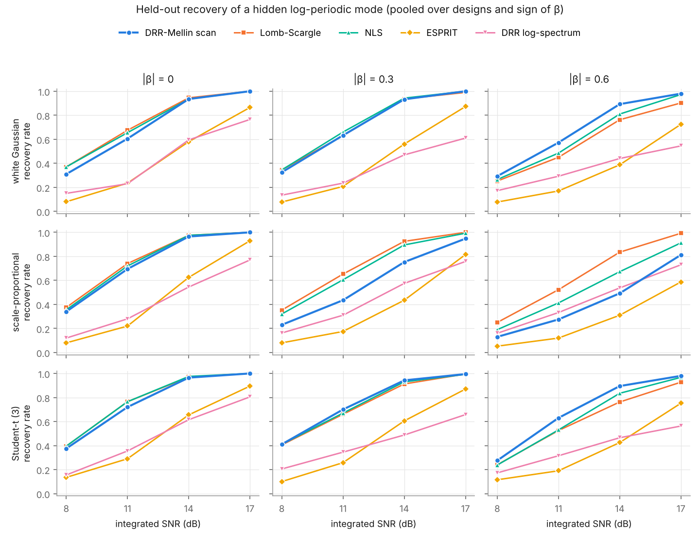

# DRR-Mellin hidden-mode recovery: a preregistered comparison

**Record:** [`results/expected/mellin_recovery/mellin_recovery_benchmark.json`](../results/expected/mellin_recovery/mellin_recovery_benchmark.json)
with a [rendered report](../results/expected/mellin_recovery/report.md) and
[figure](../results/expected/mellin_recovery/recovery.png).
**Code:** [`drr_framework.mellin_recovery_benchmark`](../src/drr_framework/mellin_recovery_benchmark.py),
[`scripts/run_mellin_recovery_benchmark.py`](../scripts/run_mellin_recovery_benchmark.py).
**Status:** exploratory research extension; simulated data only; no change to default analysis.

This study carries out the "next research step" named in
[DRR-Mellin: multiscale spectral diagnostics](mellin-multiscale.md): noisy and
off-grid trials, comparison with ordinary log-coordinate periodograms and
other estimators, false-discovery control, and a record of negative outcomes.

## The answer in brief

The study set out to test whether DRR-Mellin recovers hidden spectral
structure under noise more reliably than established methods. **As a general
claim, that is not supported.** It holds in a specific regime that was
predicted in advance and then confirmed on held-out data. All five
hypotheses and their decision rules were frozen before the held-out run.

- **Pooled over all 12,000 held-out trials, Lomb-Scargle and NLS recover the
  hidden mode more often than the DRR-Mellin scan.** Recovery: Lomb-Scargle
  0.694, NLS 0.688, DRR-Mellin scan 0.666, ESPRIT 0.392 and DRR
  `log_spectrum` 0.412. H1 is **partially supported**: the scan beats ESPRIT
  (+0.274; 3,470 paired wins to 181) but not Lomb-Scargle (-0.028) or NLS (-0.021).
- **Detection followed by recovery gives a similar picture.** At a calibrated
  5% false-alarm rate: Lomb-Scargle 0.545, DRR-Mellin scan 0.508, NLS 0.502.
  H2 is **partially supported**: the scan beats ESPRIT and NLS (+0.007, Holm
  p = 4.8e-06) but not Lomb-Scargle.
- **Where DRR-Mellin is the most reliable method tested (H3, supported):**
  modes with a strong power-law envelope (|beta| = 0.6) in additive noise.
  Under white and Student-t noise its paired recovery advantage over
  Lomb-Scargle is +0.087 at |beta| = 0.6, against -0.026 at beta = 0
  (z = 13.2, p = 4e-40). On log-uniform sampling it is larger. The post hoc
  breakdown in the report gives +0.146 (white) and +0.144 (Student-t) over
  Lomb-Scargle, and +0.086 over NLS in both, all p < 1e-13. In absolute terms,
  under white noise the scan recovers 0.626 of these modes, NLS 0.540 and
  Lomb-Scargle 0.480. The scan's joint growth-frequency search finds the mode
  where the periodogram peak, and NLS started from it, do not.
- **On integer sampling the advantage nearly vanishes:** at most +0.039 over
  Lomb-Scargle and +0.019 over NLS. There most samples sit at large x, where
  the envelope varies little (the efficiency `eta` is 0.75-0.96).
- **Predicted limitation, confirmed (H5, supported):** when the noise scales
  with the envelope, the unweighted envelope fit over-weights the noisiest
  samples. At |beta| = 0.6, Lomb-Scargle wins 366 paired trials to 10, and
  recovery is 0.650 against 0.427.
- **Searching over growth costs reliability when there is no growth (H4, not
  supported).** At beta = 0 the scan recovers 2.5 points less than
  Lomb-Scargle. The one-sided 95% lower bound, -0.032, misses the preregistered
  -0.03 margin.
- **The documented `log_spectrum` operator is not competitive** (0.412
  pooled). Its fixed `beta = 0.5` weighting is the opposite of the matched
  filter for white noise, and its unpadded FFT bins are a full Rayleigh width
  apart. It is only competitive where its weighting happens to whiten
  scale-proportional noise.
- **False alarms stay controlled for every method:** 0.042-0.049 on 7,000
  fresh noise-only records at a nominal 0.05.

The reproducible finding is therefore conditional. Under additive noise,
DRR-Mellin's joint (beta, omega) least-squares scan is the most reliable of
the tested methods for log-periodic modes with strong power-law envelopes
sampled uniformly in ln x. It is the wrong tool at constant amplitude and
under scale-proportional noise, where Lomb-Scargle is better. This is the
matched-filter efficiency argument below, confirmed on data the methods were
not developed on. It is not a new estimator in the statistical sense: the
scan is a global grid search of the least-squares (Gaussian maximum
likelihood) criterion. Its edge over NLS comes from searching growth and
frequency jointly instead of starting at the periodogram peak.




## The question

A *Mellin mode* is a power-law envelope times an oscillation in log scale,

    s(x) = x^beta cos(omega ln x + phi),

the residue pattern of a pole at `beta + i omega` of a Mellin transform. Such
log-periodic structure appears in discrete scale invariance and in explicit
formulas of analytic number theory. When the mode is buried in noise, how
often does a method return the hidden log-frequency `omega` to within half a
Rayleigh width, `|omega_hat - omega| <= pi / ln(x_max / x_min)`? And how often
does it do so after declaring a detection at a threshold calibrated to a 5%
false-alarm rate?

## Design

| Factor | Development | Held out |
| --- | --- | --- |
| Sampling | 256 points: uniform in ln x on [1, e^6]; integers 15..270 | 512 points: uniform in ln x on [1, 1000]; integers 20..531 |
| Noise | white Gaussian | white Gaussian; scale-proportional Gaussian (standard deviation follows the envelope); Student-t, 3 degrees of freedom |
| Envelope beta | -0.5, 0, 0.5 | -0.6, -0.3, 0, 0.3, 0.6 |
| Integrated SNR (dB) | 6, 9, 12, 15, 18 | 8, 11, 14, 17 |
| Trials | 60 per condition; 300 + 300 null records per noise group | 100 per condition (12,000); 500 + 500 null records per noise group (14 groups) |

`omega` is drawn uniformly from [8, 40] and the phase uniformly from
[0, 2 pi), so the true frequency is almost never on any method's grid. The
integrated SNR is `n * mean(s^2) / mean(sigma^2)`. Each condition and null
group has its own seed (`SeedSequence([20261125, offset])`), and development
and held-out offsets are disjoint.

Detection thresholds are rank quantiles of each method's statistic on 500
noise-only calibration records of the same design and noise model; a further
500 fresh null records per group measure the realized false-alarm rate.

## Methods

Every method receives the same samples `(x, y)`.

| Method | Family | What it computes |
| --- | --- | --- |
| `drr_mellin_scan` | DRR-Mellin (primary) | `mellin.log_mode_profile`, the closed form of `fit_log_mode`: joint least-squares scan over 17 growth exponents in [-1, 1] and 581 log-frequencies in [2, 60] |
| `drr_log_spectrum` | DRR-Mellin (secondary) | `mellin.log_spectrum` with its documented `beta = 0.5` weighting |
| `lomb_scargle` | established | `scipy.signal.lombscargle` against ln x on the same frequency grid, the standard periodogram for log-periodicity (Zhou & Sornette 2002) |
| `nls` | established | `scipy.optimize.least_squares` fit of the full mode, started at the Lomb-Scargle peak with beta = 0 |
| `esprit` | established | least-squares ESPRIT, model order 2, Hankel depth n // 3 |

On the integer design, `drr_log_spectrum` and `esprit` need a uniform ln-x
grid and receive a linear interpolation onto 512 such points. The scan's
candidate grid is the largest `fit_log_mode` accepts (9,877 of 10,000 pairs).
`tests/test_mellin_recovery_benchmark.py` checks that the profile selects the
candidate `fit_log_mode` returns. The benchmark repeats that check on the first
trial of every condition and records it as an integrity check.

## Why the hypotheses predict what they do

At the true frequency, a linear statistic with template `t` has SNR
proportional to `(sum t s)^2 / sum t^2 sigma^2`. For white noise the
envelope-matched template of the DRR scan is optimal, while the
constant-amplitude Lomb-Scargle template keeps the fraction

    eta(beta) = (mean x^beta)^2 / mean x^(2 beta)  <= 1

of that SNR (Cauchy-Schwarz; equality only at beta = 0). When noise scales
with the envelope (`sigma ~ x^beta`), the optimal template is whitened.
Lomb-Scargle then keeps `eta(beta)` and the unweighted envelope fit only
`eta(2 beta)`, which is smaller. On the held-out grids:

| Design | beta | Lomb-Scargle / DRR, white noise | DRR, scale noise | Lomb-Scargle, scale noise |
| --- | ---: | ---: | ---: | ---: |
| uniform in ln x | +/-0.3 | 0.749 | 0.467 | 0.749 |
| uniform in ln x | +/-0.6 | 0.467 | 0.241 | 0.467 |
| integers | +0.3 | 0.961 | 0.884 | 0.961 |
| integers | +0.6 | 0.884 | 0.728 | 0.884 |
| integers | -0.6 | 0.745 | 0.315 | 0.745 |

These ratios ignore the cost of searching over beta and the threshold
behaviour of argmax estimators. That is why they motivate the hypotheses
rather than replace the experiment. H3 predicts the gain under additive noise.
H5 predicts the loss under scale-proportional noise.

## Preregistration and audit trail

`DEFAULT_CONFIG["preregistration"]` fixes the endpoints, comparators, decision
rules and five hypotheses. `preregistration_sha256` fingerprints them together
with the seed, grids, method settings and every held-out condition:
`a6fbf4ed6de44c779ef8f14baae5a46ea85c40a3ff52e397a25aad8a8d31361e`. That
fingerprint, the code and the development-only artifact were committed and
pushed (commit `e0c03ea`) before any held-out condition was run. Before
freezing, the methods were smoke-tested on single records at 30 dB on the
held-out sampling grids, with unrelated seeds, to check that they ran.

## Reproduce

```bash
python -m pip install -e ".[dev]" -c experiments/financial_holdout/requirements.txt
python -m pytest tests/test_mellin.py tests/test_mellin_recovery_benchmark.py -q
python scripts/run_mellin_recovery_benchmark.py --workers 4 \
  --output-dir /tmp/mellin-recovery --verify-against results/expected/mellin_recovery
```

The replay recomputes all 30,000 development and held-out records. It fails
unless every per-trial code, calibrated threshold, accuracy summary and
hypothesis outcome matches the committed artifact. It takes about ten minutes
on four cores. The script fixes one numerical thread per process, and rows
do not depend on `--workers`. The
[`DRR-Mellin recovery replay`](../.github/workflows/mellin-recovery.yml)
workflow runs the same replay on every pull request. The committed run used
Python 3.13, NumPy 2.3.5 and SciPy 1.17.0; the workflow uses Python 3.12
with the same pins.

## Limitations and what this does not show

- **Simulated, single-mode records only.** No multi-mode separation, trends,
  coloured or dependent noise, missing data, or real measurements. The
  arithmetic application in [`mellin-multiscale.md`](mellin-multiscale.md) is
  not tested here.
- **Idealized calibration.** Detection thresholds come from noise-only
  records of the true noise model. Real data would need surrogate or
  bootstrap calibration, which could change the detection rankings.
- **Comparator choices.** NLS starts once, at the Lomb-Scargle peak. A
  multi-start NLS, or NLS refined from the DRR grid, would probably match or
  beat the scan. Weighted Lomb-Scargle or weighted least squares (which
  addresses H5) and matrix-pencil methods for irregular samples were not
  tested. ESPRIT and `log_spectrum` receive linear interpolation on the
  integer design, which handicaps them there.
- **Pooling depends on the design.** H1 and H2 pool an equal number of
  trials from each design, noise model, envelope and SNR, and a different mix
  would change the pooled ranking. The conditional statements (H3, H5) do not
  depend on that mix.
- **Grid resolution.** The scan's omega grid step is 0.1, so its accuracy
  among recovered trials is limited by quantization (omega RMSE 0.261 vs
  Lomb-Scargle 0.258 and NLS 0.267). Recovery uses a tolerance of half a
  Rayleigh width, 0.45-0.96, far above the grid step.
- **Post hoc breakdown.** The design-by-noise-by-envelope table in the report
  was added after the held-out run to locate the regime behind H1 and H3. It
  is exploratory, with 36 unadjusted comparisons per endpoint.
- **Replay is exact only within the pinned environment.** A different BLAS
  or SciPy could, in principle, flip rare near-ties between grid candidates.
  `tests/test_mellin_recovery_benchmark.py` replays a prefix of committed rows
  on every CI Python version, and the replay workflow checks every trial
  under the pins.


## References

- Lomb (1976), Least-squares frequency analysis of unequally spaced data, https://doi.org/10.1007/BF00648343
- Scargle (1982), Studies in astronomical time series analysis II, https://doi.org/10.1086/160554
- Roy & Kailath (1989), ESPRIT: estimation of signal parameters via rotational invariance techniques, https://doi.org/10.1109/29.32276
- Zhou & Sornette (2002), Statistical significance of periodicity and log-periodicity with heavy-tailed correlated noise, Int. J. Mod. Phys. C 13, 137, https://doi.org/10.1142/S0129183102003024
- Stoica & Moses (2005), *Spectral Analysis of Signals*, Prentice Hall
