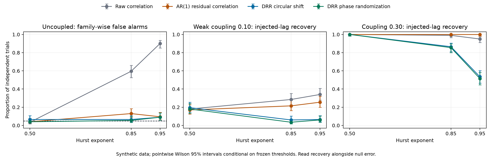

# DRR robustness benchmark

Schema: `drr-robustness-benchmark-v1`. Config SHA-256: `691b9c6184139f2a7663ff671ffc635049d04f99e0a039aae2d23d0aa4d989f5`.
200 independent trials per case; 512 samples per window;
lags 1-4; 99 surrogates; alpha 0.05.

## Frozen calibration

Baselines use 399 separate white-noise trials. Reject strictly above
order statistic 380 of the family maxima. No evaluation data
selects a threshold. Both baselines search the same directed pairs and lags.

- `raw_correlation`: threshold 0.134872.
- `ar1_residual_correlation`: threshold 0.135734.

## Methods

- `raw_correlation`: Max-over-lags correlation; white-noise calibrated family maximum.
- `ar1_residual_correlation`: Per-window AR(1) residual correlation; separately white-noise calibrated family maximum.
- `drr_circular_shift`: Existing RootingAnalyzer: circular-shift max-statistic p-values and candidate-edge gate.
- `drr_phase_randomization`: Existing RootingAnalyzer: phase-randomization max-statistic p-values and candidate-edge gate.

## Trial-level results

Rates have pointwise Wilson 95% intervals across trials. Windows within a trial are paired;
they are never pooled as independent replicates. Non-injected directions include the reverse
and distractor pairs. Under coupling, autocorrelation can induce additional associations;
these are off-target relative to the generator, not necessarily false statistical relationships.
On uncoupled windows every reported direction is a family-wise false alarm.

| Case | Window | Method | Injected direction + lag | Any non-injected direction | Null assessment |
| --- | ---: | --- | --- | --- | --- |
| fgn_0.50_coupling_0.00 | 0 | raw_correlation | n/a (no injected edge) | 0.035 [0.017, 0.070] | inconclusive |
| fgn_0.50_coupling_0.00 | 0 | ar1_residual_correlation | n/a (no injected edge) | 0.040 [0.020, 0.077] | inconclusive |
| fgn_0.50_coupling_0.00 | 0 | drr_circular_shift | n/a (no injected edge) | 0.065 [0.038, 0.108] | inconclusive |
| fgn_0.50_coupling_0.00 | 0 | drr_phase_randomization | n/a (no injected edge) | 0.040 [0.020, 0.077] | inconclusive |
| fgn_0.50_coupling_0.10 | 0 | raw_correlation | 0.180 [0.133, 0.239] | 0.030 [0.014, 0.064] | n/a (coupled) |
| fgn_0.50_coupling_0.10 | 0 | ar1_residual_correlation | 0.170 [0.124, 0.228] | 0.030 [0.014, 0.064] | n/a (coupled) |
| fgn_0.50_coupling_0.10 | 0 | drr_circular_shift | 0.195 [0.146, 0.255] | 0.025 [0.011, 0.057] | n/a (coupled) |
| fgn_0.50_coupling_0.10 | 0 | drr_phase_randomization | 0.180 [0.133, 0.239] | 0.040 [0.020, 0.077] | n/a (coupled) |
| fgn_0.50_coupling_0.30 | 0 | raw_correlation | 1.000 [0.981, 1.000] | 0.050 [0.027, 0.090] | n/a (coupled) |
| fgn_0.50_coupling_0.30 | 0 | ar1_residual_correlation | 1.000 [0.981, 1.000] | 0.060 [0.035, 0.102] | n/a (coupled) |
| fgn_0.50_coupling_0.30 | 0 | drr_circular_shift | 1.000 [0.981, 1.000] | 0.005 [0.001, 0.028] | n/a (coupled) |
| fgn_0.50_coupling_0.30 | 0 | drr_phase_randomization | 1.000 [0.981, 1.000] | 0.010 [0.003, 0.036] | n/a (coupled) |
| fgn_0.50_coupling_0.50 | 0 | raw_correlation | 1.000 [0.981, 1.000] | 0.075 [0.046, 0.120] | n/a (coupled) |
| fgn_0.50_coupling_0.50 | 0 | ar1_residual_correlation | 1.000 [0.981, 1.000] | 0.085 [0.054, 0.132] | n/a (coupled) |
| fgn_0.50_coupling_0.50 | 0 | drr_circular_shift | 1.000 [0.981, 1.000] | 0.000 [0.000, 0.019] | n/a (coupled) |
| fgn_0.50_coupling_0.50 | 0 | drr_phase_randomization | 1.000 [0.981, 1.000] | 0.000 [0.000, 0.019] | n/a (coupled) |
| fgn_0.85_coupling_0.00 | 0 | raw_correlation | n/a (no injected edge) | 0.595 [0.526, 0.661] | inflated |
| fgn_0.85_coupling_0.00 | 0 | ar1_residual_correlation | n/a (no injected edge) | 0.130 [0.090, 0.184] | inflated |
| fgn_0.85_coupling_0.00 | 0 | drr_circular_shift | n/a (no injected edge) | 0.065 [0.038, 0.108] | inconclusive |
| fgn_0.85_coupling_0.00 | 0 | drr_phase_randomization | n/a (no injected edge) | 0.055 [0.031, 0.096] | inconclusive |
| fgn_0.85_coupling_0.10 | 0 | raw_correlation | 0.285 [0.227, 0.351] | 0.575 [0.506, 0.641] | n/a (coupled) |
| fgn_0.85_coupling_0.10 | 0 | ar1_residual_correlation | 0.215 [0.164, 0.277] | 0.065 [0.038, 0.108] | n/a (coupled) |
| fgn_0.85_coupling_0.10 | 0 | drr_circular_shift | 0.060 [0.035, 0.102] | 0.045 [0.024, 0.083] | n/a (coupled) |
| fgn_0.85_coupling_0.10 | 0 | drr_phase_randomization | 0.035 [0.017, 0.070] | 0.045 [0.024, 0.083] | n/a (coupled) |
| fgn_0.85_coupling_0.30 | 0 | raw_correlation | 0.990 [0.964, 0.997] | 0.655 [0.587, 0.717] | n/a (coupled) |
| fgn_0.85_coupling_0.30 | 0 | ar1_residual_correlation | 1.000 [0.981, 1.000] | 0.085 [0.054, 0.132] | n/a (coupled) |
| fgn_0.85_coupling_0.30 | 0 | drr_circular_shift | 0.865 [0.811, 0.906] | 0.070 [0.042, 0.114] | n/a (coupled) |
| fgn_0.85_coupling_0.30 | 0 | drr_phase_randomization | 0.855 [0.800, 0.897] | 0.065 [0.038, 0.108] | n/a (coupled) |
| fgn_0.85_coupling_0.50 | 0 | raw_correlation | 1.000 [0.981, 1.000] | 0.760 [0.696, 0.814] | n/a (coupled) |
| fgn_0.85_coupling_0.50 | 0 | ar1_residual_correlation | 1.000 [0.981, 1.000] | 0.095 [0.062, 0.144] | n/a (coupled) |
| fgn_0.85_coupling_0.50 | 0 | drr_circular_shift | 0.995 [0.972, 0.999] | 0.025 [0.011, 0.057] | n/a (coupled) |
| fgn_0.85_coupling_0.50 | 0 | drr_phase_randomization | 0.995 [0.972, 0.999] | 0.020 [0.008, 0.050] | n/a (coupled) |
| fgn_0.95_coupling_0.00 | 0 | raw_correlation | n/a (no injected edge) | 0.900 [0.851, 0.934] | inflated |
| fgn_0.95_coupling_0.00 | 0 | ar1_residual_correlation | n/a (no injected edge) | 0.095 [0.062, 0.144] | inflated |
| fgn_0.95_coupling_0.00 | 0 | drr_circular_shift | n/a (no injected edge) | 0.090 [0.058, 0.138] | inflated |
| fgn_0.95_coupling_0.00 | 0 | drr_phase_randomization | n/a (no injected edge) | 0.090 [0.058, 0.138] | inflated |
| fgn_0.95_coupling_0.10 | 0 | raw_correlation | 0.340 [0.278, 0.408] | 0.855 [0.800, 0.897] | n/a (coupled) |
| fgn_0.95_coupling_0.10 | 0 | ar1_residual_correlation | 0.255 [0.200, 0.320] | 0.080 [0.050, 0.126] | n/a (coupled) |
| fgn_0.95_coupling_0.10 | 0 | drr_circular_shift | 0.065 [0.038, 0.108] | 0.075 [0.046, 0.120] | n/a (coupled) |
| fgn_0.95_coupling_0.10 | 0 | drr_phase_randomization | 0.060 [0.035, 0.102] | 0.090 [0.058, 0.138] | n/a (coupled) |
| fgn_0.95_coupling_0.30 | 0 | raw_correlation | 0.950 [0.910, 0.973] | 0.825 [0.766, 0.871] | n/a (coupled) |
| fgn_0.95_coupling_0.30 | 0 | ar1_residual_correlation | 1.000 [0.981, 1.000] | 0.105 [0.070, 0.155] | n/a (coupled) |
| fgn_0.95_coupling_0.30 | 0 | drr_circular_shift | 0.535 [0.466, 0.603] | 0.125 [0.086, 0.178] | n/a (coupled) |
| fgn_0.95_coupling_0.30 | 0 | drr_phase_randomization | 0.515 [0.446, 0.583] | 0.095 [0.062, 0.144] | n/a (coupled) |
| fgn_0.95_coupling_0.50 | 0 | raw_correlation | 1.000 [0.981, 1.000] | 0.955 [0.917, 0.976] | n/a (coupled) |
| fgn_0.95_coupling_0.50 | 0 | ar1_residual_correlation | 1.000 [0.981, 1.000] | 0.095 [0.062, 0.144] | n/a (coupled) |
| fgn_0.95_coupling_0.50 | 0 | drr_circular_shift | 0.960 [0.923, 0.980] | 0.175 [0.129, 0.234] | n/a (coupled) |
| fgn_0.95_coupling_0.50 | 0 | drr_phase_randomization | 0.950 [0.910, 0.973] | 0.150 [0.107, 0.206] | n/a (coupled) |
| coupling_onset | 0 | raw_correlation | n/a (no injected edge) | 0.635 [0.566, 0.699] | inflated |
| coupling_onset | 0 | ar1_residual_correlation | n/a (no injected edge) | 0.105 [0.070, 0.155] | inflated |
| coupling_onset | 0 | drr_circular_shift | n/a (no injected edge) | 0.085 [0.054, 0.132] | inflated |
| coupling_onset | 0 | drr_phase_randomization | n/a (no injected edge) | 0.050 [0.027, 0.090] | inconclusive |
| coupling_onset | 1 | raw_correlation | 0.970 [0.936, 0.986] | 0.685 [0.618, 0.745] | n/a (coupled) |
| coupling_onset | 1 | ar1_residual_correlation | 1.000 [0.981, 1.000] | 0.080 [0.050, 0.126] | n/a (coupled) |
| coupling_onset | 1 | drr_circular_shift | 0.795 [0.734, 0.845] | 0.065 [0.038, 0.108] | n/a (coupled) |
| coupling_onset | 1 | drr_phase_randomization | 0.810 [0.750, 0.858] | 0.075 [0.046, 0.120] | n/a (coupled) |
| coupling_offset | 0 | raw_correlation | 0.975 [0.943, 0.989] | 0.645 [0.577, 0.708] | n/a (coupled) |
| coupling_offset | 0 | ar1_residual_correlation | 1.000 [0.981, 1.000] | 0.075 [0.046, 0.120] | n/a (coupled) |
| coupling_offset | 0 | drr_circular_shift | 0.825 [0.766, 0.871] | 0.095 [0.062, 0.144] | n/a (coupled) |
| coupling_offset | 0 | drr_phase_randomization | 0.835 [0.777, 0.880] | 0.070 [0.042, 0.114] | n/a (coupled) |
| coupling_offset | 1 | raw_correlation | n/a (no injected edge) | 0.570 [0.501, 0.637] | inflated |
| coupling_offset | 1 | ar1_residual_correlation | n/a (no injected edge) | 0.060 [0.035, 0.102] | inconclusive |
| coupling_offset | 1 | drr_circular_shift | n/a (no injected edge) | 0.045 [0.024, 0.083] | inconclusive |
| coupling_offset | 1 | drr_phase_randomization | n/a (no injected edge) | 0.055 [0.031, 0.096] | inconclusive |
| direction_reversal | 0 | raw_correlation | 0.970 [0.936, 0.986] | 0.705 [0.638, 0.764] | n/a (coupled) |
| direction_reversal | 0 | ar1_residual_correlation | 1.000 [0.981, 1.000] | 0.055 [0.031, 0.096] | n/a (coupled) |
| direction_reversal | 0 | drr_circular_shift | 0.765 [0.702, 0.818] | 0.050 [0.027, 0.090] | n/a (coupled) |
| direction_reversal | 0 | drr_phase_randomization | 0.770 [0.707, 0.823] | 0.050 [0.027, 0.090] | n/a (coupled) |
| direction_reversal | 1 | raw_correlation | 0.980 [0.950, 0.992] | 0.690 [0.623, 0.750] | n/a (coupled) |
| direction_reversal | 1 | ar1_residual_correlation | 1.000 [0.981, 1.000] | 0.095 [0.062, 0.144] | n/a (coupled) |
| direction_reversal | 1 | drr_circular_shift | 0.810 [0.750, 0.858] | 0.050 [0.027, 0.090] | n/a (coupled) |
| direction_reversal | 1 | drr_phase_randomization | 0.825 [0.766, 0.871] | 0.055 [0.031, 0.096] | n/a (coupled) |

## Interpretation and limits

- All data are synthetic. No physical or domain-transfer validity is established.
- White-noise calibration does not establish error control under long memory or switches.
- A null row is inflated when its interval lower bound exceeds alpha. An interval crossing
  alpha is inconclusive; failure to detect inflation does not establish control.
- Intervals are pointwise, not simultaneous. No global winner or superiority test is declared.
- Rate intervals condition on the retained baseline thresholds; they do not include
  variation from drawing a new calibration set.
- Regime windows do not straddle switches; a lag-length buffer is discarded at each boundary.
  These are before/after comparisons, not measurements of online change-detection delay.
- Correlation scores and p-values are not calibrated probabilities that an edge is true.
- This is a fixed exploratory benchmark, not an independently registered confirmatory study.
- JSON retains calibration maxima, data hashes and all trial decisions for replay and audit.
